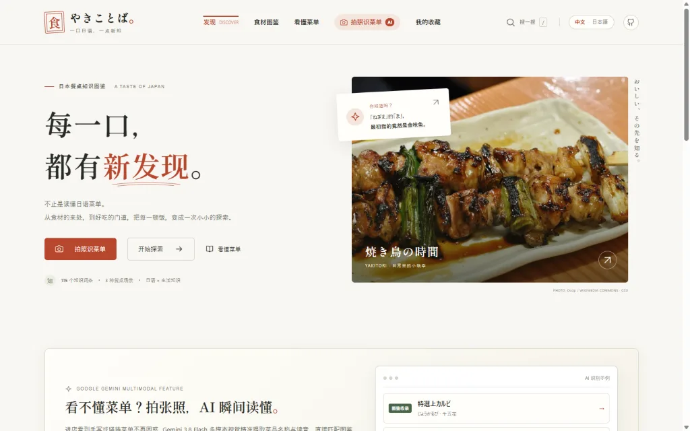

# やきことば · Yaki Kotoba

**中文** · [日本語](README.ja.md) · [English](README.en.md)

[](https://yakikotoba.pages.dev/)
[](https://github.com/xuing/yakikotoba/actions/workflows/ci.yml)
[](LICENSE)
[](https://astro.build)
[](package.json)

**日本餐桌知识图鉴与 AI 菜单识别助手** —— 从烤肉、烧鸟到寿司与鱼，把日语菜单名、食材部位、店铺叫法、离线发音与背后的饮食故事连在一起。支持中 / 日界面切换与响应式移动端体验。

## 在线预览（Live Demo）

- **主站与图鉴**：https://yakikotoba.pages.dev/
- **AI 拍照识菜单**：https://yakikotoba.pages.dev/scan/
- **8 家连锁店菜单**：https://yakikotoba.pages.dev/menus/
- **完整三语词典**：https://yakikotoba.pages.dev/menu/

[](https://yakikotoba.pages.dev/)

---

## 核心功能

- **探索首页与互动图鉴（`/`, `/?view=atlas`, `/learn/<group>/<id>/`）**
  收录 **115 个词条**（烤肉 37 · 烧鸟 20 · 寿司与鱼 58），提供日・中・英三语对照、假名注音（`{漢字|かな}`）、实物/部位图、文化背景与参考文献，支持场景筛选、`每日一口` 小问答与 `/` 快捷键全站搜索（支持中文、汉字、假名与罗马字）。
- **AI 拍照识菜单（`/scan/`）**
  基于 **Gemini 3.8 Flash** 多模态视觉，支持手机拍照、相册上传、拖拽图片以及 **3 张内置示例菜单**（烤肉 / 烧鸟 / 寿司），精准识别手写或竖排日语菜名：既可直连官方图鉴词条查看详情与发音，也可为小菜、酒水等图鉴外菜品生成 AI 实时解析。
- **8 家连锁店菜单对照（`/menus/`）**
  按餐饮场景整理 **焼肉きんぐ、牛角、叙々苑、鳥貴族、秋吉、スシロー、くら寿司、はま寿司** 的真实菜单叫法与招牌菜品，帮助把同一种食材对应到不同店的写法。
- **完整三语菜单词典（`/menu/`）**
  面向快速查阅的三语表格视图，支持按分类与连锁店筛选、高清图片灯箱（附完整摄影出处）与 **Gemini TTS** 预生成离线日语发音（缺失音频自动回退浏览器 `speechSynthesis`）。
- **本地收藏与已读进度（`/?view=saved`）**
  收藏与“已学会”标记全部保存在浏览器 `localStorage`，免登录即可随时回顾。

---

## 技术栈与目录结构

- **前端框架**：Astro 7（静态生成 + 零冗余运行时的交互脚本）、原生 CSS 设计系统、Wanakana / Sharp 图片优化
- **内容与校验**：YAML 内容集合 (`src/content/`) + `yaml` / Zod Schema 校验
- **AI 与语音**：Google Gemini 3.8 Flash（菜单视觉识别，经 Cloudflare Pages Functions 代理）与 Gemini TTS + `ffmpeg`（内容寻址离线 MP3 发音）

| 路径 | 说明 |
|---|---|
| `src/pages/` | 站点页面路由：`index.astro`、`learn/[group]/[id].astro`、`menus.astro`、`menu.astro`、`scan.astro` |
| `src/content/` | YAML 数据源：`tabs/`（3 个分类）、`groups/`（13 组 115 个词条）、`chains/`（8 家连锁店） |
| `src/assets/media/` | 食材、菜品与店铺 Logo 图库（每个目录均有 `meta.yaml` 记录出处与许可） |
| `src/data/` | 构建期索引数据：`canonical-ids.json`（AI 识别词条匹配库）与 `audio.json`（语音文件映射） |
| `src/lib/` & `src/scripts/` | 内容模型构建、注音解析、Gemini 提示词/API 封装与前端交互逻辑 |
| `functions/api/scan.ts` | Cloudflare Pages Functions `/api/scan` 边缘接口（含频率限制与图片大小校验） |
| `public/` | 静态资源：离线日语发音 `audio/*.mp3` 与示例菜单 `sample-menus/*.jpg` |
| `scripts/` | 工具脚本：`check.mjs`、`build-scan-data.mjs`、`tts.mjs`、`generate-sample-menus.mjs` |
| `docs/CONTENT.md` | 内容格式规范、注音规则与词条维护文档 |
| `CONTRIBUTING.md` | 贡献流程、图片版权要求与提交前校验说明 |
| `LICENSE` | MIT 开源协议及第三方媒体/图片归属声明 |

---

## 快速开始

### 环境要求

- **Node.js `>= 22.0.0`**（推荐 `22` LTS）
- 如需本地运行 `npm run tts` 生成新语音，需额外安装 **`ffmpeg`** 并加入 `PATH`

### 安装与启动

```bash
git clone https://github.com/xuing/yakikotoba.git
cd yakikotoba
npm install
cp .env.example .env   # 可选：若本地调试 /scan/ 或运行 npm run tts，填入 GEMINI_API_KEY
npm run dev            # 启动本地开发服务器：http://localhost:4321/
```

### 常用命令

| 命令 | 说明 |
|---|---|
| `npm install` | 安装项目依赖 |
| `npm run dev` | 启动 Astro 本地开发服务器（内置 `/api/scan` 开发代理中间件） |
| `npm run check` | 校验词条 ID、连锁店引用、图片/`meta.yaml`、`canonical-ids.json` 与音频清单一致性 |
| `npm run build` | 生成纯静态站点构建产物到 `dist/` |
| `npm run preview` | 本地预览 `dist/` 构建结果 |
| `npm run scan:data` | 从 `src/content/` 重新生成 `src/data/canonical-ids.json` |
| `npm run tts` | 调用 Gemini TTS 与 `ffmpeg` 为缺失词条生成 MP3 并更新 `src/data/audio.json` |
| `npm run sample:menus` | 重新生成 `public/sample-menus/` 下的 3 张内置示例菜单图片 |
| `npm run deploy` | 构建站点并通过 Wrangler 部署到 Cloudflare Pages (`yakikotoba.pages.dev`) |

### 环境变量（`.env`）

| 变量名 | 必填 | 默认值 | 说明 |
|---|---|---|---|
| `GEMINI_API_KEY` | 识别/TTS 必填 | — | Google Gemini API 密钥（支持单个密钥、`["key1","key2"]` 数组或 `key1,key2` 逗号分隔多密钥自动轮询与 `429` 故障转移）；仅静态浏览可留空 |
| `GEMINI_SCAN_MODEL` | 否 | `gemini-3.8-flash` | `/api/scan` 使用的 Gemini 多模态视觉模型 |
| `GEMINI_TTS_MODEL` | 否 | `gemini-3.8-flash-lite-tts` | `npm run tts` 使用的语音合成模型 |
| `GEMINI_TTS_VOICE` | 否 | `Kore` | `npm run tts` 使用的预置语音音色 |
| `PUBLIC_SITE_URL` | 否 | `https://yakikotoba.pages.dev` | 站点规范域名，用于构建时生成 `canonical` 与 OpenGraph 元标签 |

---

## 部署指南

### 方式一：Cloudflare Pages（推荐，完整支持 `/scan/` AI 识菜单）

仓库已包含 [`wrangler.toml`](wrangler.toml) 与 [`functions/api/scan.ts`](functions/api/scan.ts)，可将静态页面与 `/api/scan` Serverless Function 一同部署：

1. 在 Cloudflare Pages 关联本仓库：
   - **Build command**: `npm run build`
   - **Build output directory**: `dist`
2. 在 Cloudflare Pages 项目设置的 **Settings → Environment variables / Secrets** 中添加 `GEMINI_API_KEY`（可选配置 `GEMINI_SCAN_MODEL` 与 `PUBLIC_SITE_URL`）。
3. 若使用 Wrangler CLI 本地/手动部署，请确保 `Node >= 22` 构建环境并设置 `GEMINI_API_KEY` Secret。

### 方式二：纯静态托管（GitHub Pages / Netlify Static / Nginx / 对象存储）

执行 `npm run build` 后直接托管 `dist/` 目录即可。首页、食材图鉴、115 个词条详情页、8 家连锁店入口、三语菜单词典与已生成的离线发音均可完整离线/静态运行；但 `/scan/` 页面的 `/api/scan` 接口需要 Serverless 后端来安全代理 `GEMINI_API_KEY`，纯静态托管环境下 AI 拍照识别功能不可用。

---

## 内容贡献与版权说明

- **新增或修订词条 / 连锁店**：请先阅读 [内容格式与维护指南 (`docs/CONTENT.md`)](docs/CONTENT.md) 与 [贡献指南 (`CONTRIBUTING.md`)](CONTRIBUTING.md)，并在提交 PR 前执行 `npm run scan:data && npm run check && npm run build`。
- **图片出处与开源许可**：本项目源码采用 [MIT License](LICENSE) 开源；日本农林水产省（MAFF）公开数据图鉴、Wikimedia Commons 开放授权摄影作品及各餐饮品牌官网参考图的详细授权与归属说明，请参阅 [LICENSE](LICENSE) 与各媒体目录下的 `meta.yaml`。
